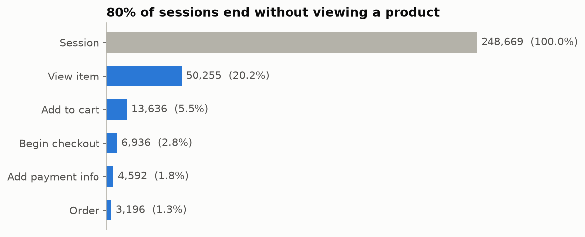
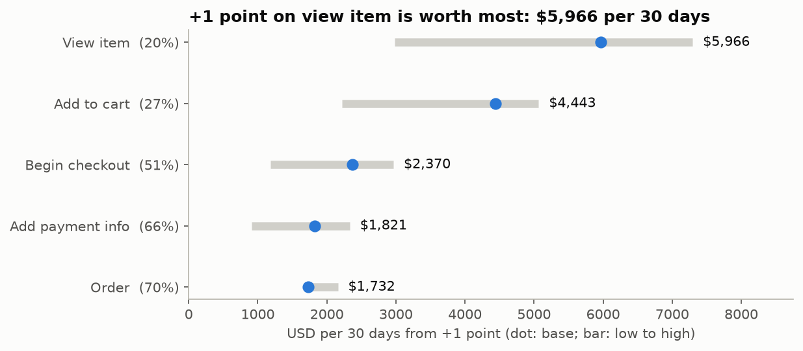
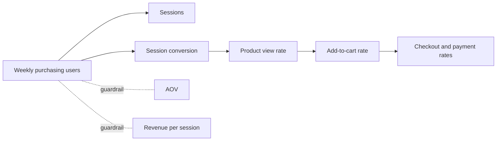

# Merch Store product analytics

[](https://github.com/Aaad1tyaaA/merch-store-product-analytics/actions/workflows/ci.yml)

**Bottom line for the Head of Growth: fix product discovery first.** 79.8% of sessions never view a product. One extra point at that step is worth about $6.0k per 30 days (range $3.0k–$7.3k), more than any later step. New visitors are the weakest segment there. Test a best-seller grid for new visitors: three weeks, 29,259 users per arm, powered for a 5% lift.

[Decision memo (PDF)](docs/memo.pdf) · [Dashboard (Power BI)](docs/power_bi.md) · [Funnel and test-planner app](app/streamlit_app.py) · [Experiment design](docs/experiment_design.md) · [Metric definitions](docs/metric_definitions.md) · [Cleaning log](docs/cleaning_log.md)

<p> </p>

| Question | Finding | What it means |
|---|---|---|
| Where are buyers lost? | 248,669 sessions → 20.2% view a product → 5.5% add to cart → 1.29% order | The leaks before the cart dwarf checkout |
| Which leak is worth most? | +1 point: product view $5,966, add to cart $4,443, checkout steps $1,732–$2,370 per 30 days | Start with product discovery |
| Who struggles most? | New sessions view a product 18.5% of the time against 25.3% for returning ones, and convert at 0.65% against 3.16% | Target new visitors |
| India vs US? | Every step's 95% interval overlaps (conversion 1.26% vs 1.28%) | No clear difference |
| What predicts a later purchase? | First-session add to cart: 5.6% vs 0.52% buy within 30 days; odds ratio 2.0; out-of-time AUC 0.87 | Activation metric (predictive, not causal) |
| Which channels bring buyers? | Paid Search: 4.9% of new users, 2.7% of their revenue | Review paid targeting before scaling |



**How I got there**

1. Flattened GA4's nested events in BigQuery and reconciled 4,295,584 events, 270,154 users, 92 days and 17 event types locally.
2. Modelled sessions as `user_pseudo_id` + `ga_session_id` (360,129) and orders as deduplicated valid transaction ids (4,451).
3. Found tracking gaps (add to cart missing for most of November; order ids missing after 25 January) and limited funnels to 26 Nov – 25 Jan.
4. Ranked funnel steps by revenue at stake with low/base/high sensitivity, and compared segments with 95% margins of error.
5. Validated first-session add to cart as an activation metric with logistic regression, tested out of time.
6. Designed the test: power, CUPED (no gain for new users), SRM check, guardrails and a decision rule fixed before launch.

**Reproduce**

```powershell
python -m venv .venv; .\.venv\Scripts\Activate.ps1
pip install -r requirements.txt
gcloud auth application-default login --disable-quota-project   # only needed to download
python scripts/run_all.py <project-id>
```

`run_all.py` downloads the Parquet extracts only if they are missing (BigQuery sandbox, about 1 GB). It then builds `ga4.duckdb`, executes the notebooks, exports the app and dashboard data, regenerates the Power BI project and runs the tests. `pytest` alone runs in CI without BigQuery, on a synthetic fixture. Run the app with `streamlit run app/streamlit_app.py`.

**Repo map**

| Path | Contents |
|---|---|
| `01_` – `06_*.ipynb` | Source checks, session model, funnel, activation and retention, channels and products, experiment design (executed, with outputs) |
| `sql/` | BigQuery extraction, model (`02_model.sql`), reporting tables (`03_metrics.sql`) |
| `scripts/` | Download, database build, shared analysis functions, exports, Power BI generator, memo PDF |
| `app/` | Streamlit app, running on the small aggregates in `app/data/` |
| `dashboard/` | Power BI project (PBIR + TMDL) reading `dashboard/data/*.csv` |
| `docs/` | Memo, experiment design, metric definitions, cleaning log, Power BI guide, data dictionary, AI log |
| `tests/` | Model rules on synthetic data, full-data checks, dashboard and app smoke tests |

**Data and limits**

The source is Google's [obfuscated GA4 sample](https://developers.google.com/analytics/bigquery/web-ecommerce-demo-dataset) for the Google Merchandise Store, 1 Nov 2020 – 31 Jan 2021. Google warns that its internal consistency is limited. Placeholders are counted and kept ([cleaning log](docs/cleaning_log.md)).

- **Sessions:** published analyses report 354,970 (`session_start` events) or 360,129 sessions; this repository uses 360,129 by definition.
- **Revenue:** order revenue ($307,640) is lower than the sum of purchase events ($362,165) because invalid and duplicate transaction ids are removed.
- **Users and channels:** users are cookies, channels are first-touch, and all comparisons except the proposed test are observational.
- **AI assistance:** see [docs/ai_log.md](docs/ai_log.md).
