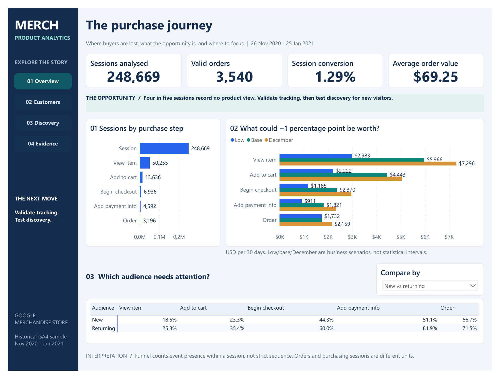
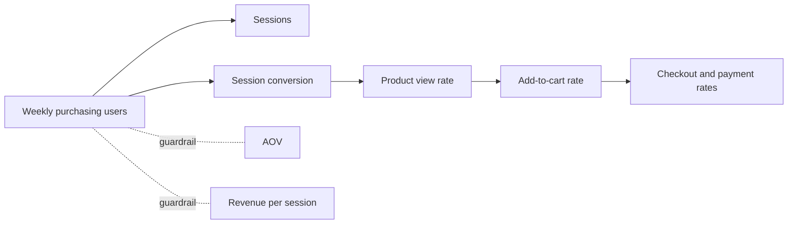

# Merch Store product analytics

[](https://github.com/Aaad1tyaaA/merch-store-product-analytics/actions/workflows/ci.yml)

**Recommendation: validate discovery tracking, then test product discovery.** 79.8% of sessions never view a product. One extra point at that step is worth about $6.0k per 30 days (range $3.0k–$7.3k), more than any later step. New visitors are the weakest segment there. Product-titled landing pages sometimes lack `view_item`, so I validate instrumentation before testing a best-seller grid for new visitors: three weeks, 29,259 users per arm, powered for a 5% lift.

[Decision memo (PDF)](docs/memo.pdf) · [Discovery evidence](docs/evidence_review.md) · [Dashboard (PDF + Power BI)](docs/power_bi.md) · [Funnel and test-planner app](app/streamlit_app.py) · [Experiment design](docs/experiment_design.md) · [Metric definitions](docs/metric_definitions.md)

[](output/pdf/merch-store-dashboard.pdf)

Four report pages: [Overview](output/dashboard/01-overview.png), [Customers](output/dashboard/02-customers.png), [Discovery](output/dashboard/03-discovery.png) and [Evidence](output/dashboard/04-evidence.png). [Download the full dashboard PDF](output/pdf/merch-store-dashboard.pdf).

To explore the interactive report on Windows, double-click **Open dashboard.cmd**, then click **Refresh** in Power BI Desktop after the first setup. The included aggregate CSVs are enough; no cloud account or BigQuery download is needed to view it.

| Question | Finding | What it means |
|---|---|---|
| Where are buyers lost? | 248,669 sessions → 20.2% view a product → 5.5% add to cart → 1.29% order | The leaks before the cart dwarf checkout |
| Which leak is worth most? | +1 point: product view $5,966, add to cart $4,443, checkout steps $1,732–$2,370 per 30 days | Start with product discovery |
| Who struggles most? | New sessions view a product 18.5% of the time against 25.3% for returning ones, and convert at 0.65% against 3.16% | Target new visitors |
| India vs US? | Every user-clustered difference interval includes zero (conversion 1.26% vs 1.28%) | No clear difference |
| What predicts a later purchase? | First-session add to cart: 5.6% vs 0.52% buy within 30 days; odds ratio 2.0; out-of-time AUC 0.87 | Activation metric (predictive, not causal) |
| Which channels bring buyers? | Paid Search: 4.9% of new users, 2.7% of their revenue | Review paid targeting before scaling |



**How I got there**

1. Flattened GA4's nested events in BigQuery and reconciled 4,295,584 events, 270,154 users, 92 days and 17 event types locally.
2. Modelled sessions as `user_pseudo_id` + `ga_session_id` (360,129) and orders as deduplicated valid transaction ids (4,451).
3. Found tracking gaps (add to cart missing for most of November; order ids missing after 25 January) and limited funnels to 26 Nov – 25 Jan.
4. Ranked funnel steps by revenue at stake with low/base/high sensitivity, and compared markets with user-clustered 95% difference intervals. I added a paired whole-user bootstrap for sampling uncertainty in revenue scenarios.
5. Checked landing/exit pages and definition sensitivity, audited tracking gaps, and estimated an adjusted observational product-view/revenue scenario. Validated first-session add to cart with an out-of-time logistic model, including calibration and a cart-only benchmark.
6. Designed the test: power, CUPED (no gain for new users), SRM check, guardrails and a decision rule fixed before launch.

**Reproduce**

I use Python 3.13. The committed notebooks, dashboard previews and aggregate CSVs can be explored without Google credentials or the raw database. To run the app from a fresh checkout:

```powershell
python -m venv .venv
.\.venv\Scripts\Activate.ps1
python -m pip install -r app/requirements.txt
python -m streamlit run app/streamlit_app.py
```

To rebuild the analysis from the public source, I install the full dependencies and authenticate with my own Google Cloud project:

```powershell
python -m pip install -r requirements.txt
gcloud auth application-default login --disable-quota-project   # only needed to download
python scripts/run_all.py <project-id>
```

`run_all.py` downloads missing Parquet extracts (about 1 GB), builds `ga4.duckdb`, generates the discovery evidence, executes the notebooks, exports app/dashboard data and runs the tests. It preserves existing Power BI definitions; `python scripts/build_dashboard.py --regenerate` backs them up before replacement. For Power BI, double-click **Open dashboard.cmd** or run `python scripts/setup_dashboard.py`; this creates a configured working report under ignored `dashboard/.local/` while keeping the shared template portable. `pytest` runs without BigQuery using synthetic fixtures, plus full-data checks when the database is present. Run the app with `streamlit run app/streamlit_app.py`.

I run `python -m pytest -q` after installing the full dependencies. GitHub Actions uses Python 3.13 on Ubuntu and Windows; the seven database checks skip on a fresh clone, while the remaining checks use the committed aggregates and synthetic fixtures. Raw extracts, credentials, the local database and Power BI working copies stay outside Git.

**Repo map**

| Path | Contents |
|---|---|
| `01_` – `07_*.ipynb` | Source checks, session model, funnel, activation and retention, channels and products, experiment design, discovery evidence and robustness (executed, with outputs) |
| `sql/` | BigQuery extraction, model (`02_model.sql`), reporting tables (`03_metrics.sql`) |
| `scripts/` | Download, database build, shared analysis functions, exports, Power BI generator, memo PDF |
| `app/` | Streamlit app, running on the small aggregates in `app/data/` |
| `dashboard/` | Shared four-page Power BI template, fourteen CSV inputs and an ignored local working copy prepared by the launcher |
| `output/` | Native Power BI PDF and full-page preview images |
| `docs/` | Memo, experiment design, metric definitions, cleaning log, Power BI guide, data dictionary, AI log |
| `tests/` | Model rules on synthetic data, full-data checks, dashboard and app smoke tests |

**Data and limits**

The source is Google's [obfuscated GA4 sample](https://developers.google.com/analytics/bigquery/web-ecommerce-demo-dataset) for the Google Merchandise Store, 1 Nov 2020 – 31 Jan 2021. Google warns that its internal consistency is limited. Placeholders are counted and kept ([cleaning log](docs/cleaning_log.md)).

- **Sessions:** published analyses report 354,970 (`session_start` events) or 360,129 sessions; this repository uses 360,129 by definition.
- **Revenue:** order revenue ($307,640) is lower than the sum of purchase events ($362,165) because invalid and duplicate transaction ids are removed.
- **Users and channels:** users are cookies, channels are first-touch, and all comparisons except the proposed test are observational.
- **AI assistance:** see [docs/ai_log.md](docs/ai_log.md).
